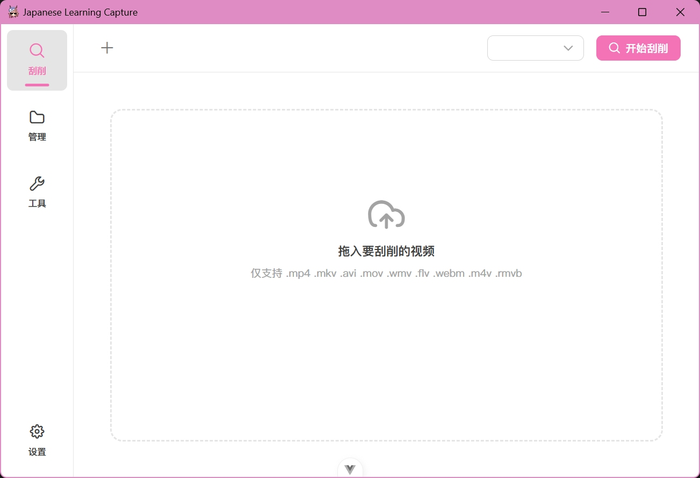

# Japanese Learning Capture

一个基于 Electron 的日语学习资料刮削与管理工具。



## 📘用法

- 批量刮削视频资料信息
- 管理本地已刮削数据

## ⚠️注意事项

- 首次运行前请确认本地刮削目录配置正确
- 某些翻译能力依赖外部 AI API 或本地模型

## 📢声明

- 本项目不提供任何视频下载，只管理本地资源
- 本项目和项目成果仅供技术，学术交流和electron性能测试使用
- 永久开源免费

## 🛠️构建

只需[安装 vp](https://viteplus.dev/guide/)，Node.js 与 pnpm 会按项目声明自动准备。

```bash
vp install      # 安装依赖
vp run dev      # 启动开发环境
vp run package  # 构建并打包到 out/
```

发布流程见 `AGENTS.md`。
