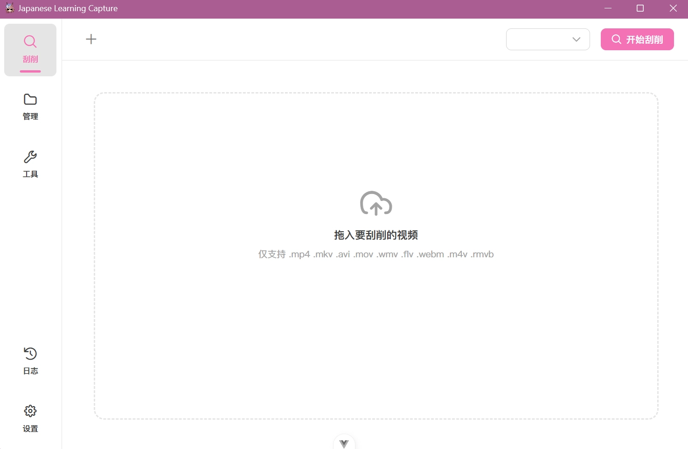

# Japanese Learning Capture

一个基于 Electron 的日语学习资料刮削与管理工具。



## ✨ 功能

- 刮削视频资料
- 管理本地已刮削数据
- 图像超分工具
- 本地AI字幕生成

## ⚠️ 注意事项

- 首次运行前请确认本地刮削目录配置正确

## 📢 声明

- 本项目不提供任何视频下载，只管理本地资源
- 本项目和项目成果仅供技术，学术交流和electron性能测试使用
- 永久开源免费

## 🛠️ 开发构建

需安装 **[vp](https://viteplus.dev/guide/)** 与 **Python 3.x**

> Node.js 与 pnpm 会按项目声明自动准备，可以不安装。

随后安装项目依赖并构建：

```bash
pip install ziglang
vp install      # 安装依赖
vp run dev      # 启动开发环境
vp run package  # 构建并打包到 out/
```

发布流程见 `AGENTS.md`。
